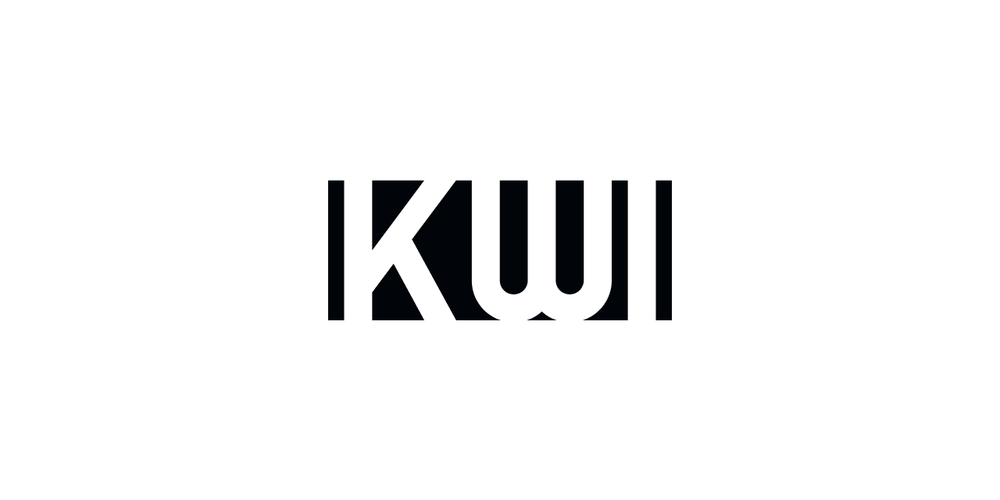

 
# KWI
 
**Open-source tools for creators.**
 
KWI (Kreative Works Initiative) builds open, lightweight and friendly software for people who make things: musicians, producers, designers and curious beginners alike. Good creative tools shouldn't depend on expensive licenses or closed ecosystems.
 
We're starting with audio, and we plan to grow from there.

---

New here? Read our [Contributing Guide](https://github.com/kreative-works-initiative/.github/blob/main/CONTRIBUTING.md). Each repository states its own license.
